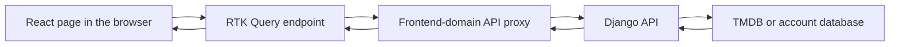
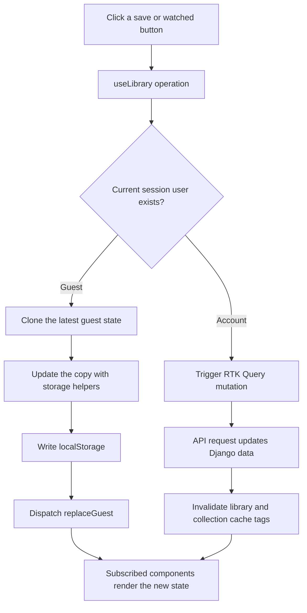

# Understanding CineScope

This guide explains the frontend in simple language and connects the files to the things you see on screen. The comments in the source files explain the important blocks beside the code.

Start with sections 1–5. Follow one user action through its files. Use the file reference later when you want to change a particular feature.

## Contents

- [1. What the application does](#1-what-the-application-does)
- [2. The small amount of React terminology you need](#2-the-small-amount-of-react-terminology-you-need)
- [3. What happens when you open CineScope](#3-what-happens-when-you-open-cinescope)
- [4. Where the application keeps information](#4-where-the-application-keeps-information)
- [5. Follow a search from typing to movie cards](#5-follow-a-search-from-typing-to-movie-cards)
- [6. Follow a Watch Trailer click](#6-follow-a-watch-trailer-click)
- [7. Follow a save or watched-status change](#7-follow-a-save-or-watched-status-change)
- [8. Collections and public sharing](#8-collections-and-public-sharing)
- [9. Sign-in and guest synchronization](#9-sign-in-and-guest-synchronization)
- [10. How to read the TypeScript and JSX](#10-how-to-read-the-typescript-and-jsx)
- [11. File-by-file reference](#11-file-by-file-reference)
- [12. Styling and responsive layouts](#12-styling-and-responsive-layouts)
- [13. Running, testing, and deploying](#13-running-testing-and-deploying)
- [14. Where to make common changes](#14-where-to-make-common-changes)
- [15. A practical reading and debugging routine](#15-a-practical-reading-and-debugging-routine)

## 1. What the application does

The frontend is the part running in your browser. It draws pages, responds to clicks, opens dialogs, and asks for data.

The Django backend answers the real API requests. It talks to TMDB, processes the responses, and stores account data.

The normal live request path is shown below.



A **request** asks a server to do something. A **response** is what the server sends back. An **endpoint** is a particular API address and HTTP method, such as `GET /api/v1/titles/`.

There is also a mock mode. In that mode MSW intercepts the same API requests and supplies demo responses inside the browser. The normal page components still call the API hooks.

## 2. The small amount of React terminology you need

### Component

A component is a function that describes a piece of the screen. `MovieCard` describes one card. `DiscoverPage` describes the Discover page. A component can contain other components.

### Props

Props are the values passed into a component by the component using it.

```tsx
<MovieCard title={t} queue={data.results} />
```

Here `title` supplies this card's movie/TV record. `queue` supplies the list that its trailer can move through.

### State

State is information React remembers between renders. A render is React running component code to calculate what the screen should display. Updating state schedules another render.

The search input's text and the mobile menu's open/closed choice are examples of local component state.

### Hook

A hook is a React function used inside a component or another hook. It gives the component access to something such as state, the URL, or a Redux value.

Names normally begin with `use`. `useState`, `useSearchParams`, `useAppSelector`, and `api.useTitlesQuery` are hooks used in this application.

### Redux, actions, and slices

Redux holds state shared by components. A **slice** defines one related part of that state. An **action** describes an update. Calling `dispatch` sends that action to Redux.

For example, a card dispatches `openTrailer(...)`. The UI slice stores the selected title/queue. `App` sees the updated state and mounts the trailer dialog.

### RTK Query

RTK Query is the API request and caching part of Redux Toolkit. It sends requests, remembers results, and exposes loading/error information to React.

A **query** reads data. A **mutation** starts a deliberate operation such as saving a title. Our recommendation API also uses a mutation because its contract requires a POST request.

### Effect

`useEffect` runs after a render to synchronize with something outside the render calculation. Examples include a keyboard listener, a search timer, or copying a session response into Redux. The dependencies at the end determine when it runs again. An effect can return a cleanup function.

## 3. What happens when you open CineScope

Read these files in this order.

1. [index.html](../index.html) contains the empty `<div id="root">` and loads `src/main.tsx`.
2. [main.tsx](../src/main.tsx) imports fonts/styles and starts the mock worker when mock mode is selected.
3. The same file mounts React into the root div. `Provider` makes Redux available. `BrowserRouter` makes browser routing available.
4. [App.tsx](../src/App.tsx) starts session restoration and matches the URL to a page.
5. [AppShell](../src/components/app-shell.tsx) supplies the shared navigation/footer around its child pages. Its `<Outlet />` is where the current child page appears.
6. The chosen page reads its data and renders its components.

The `/` Welcome route sits outside `AppShell`. Discover, Library, collection detail, shared collections, email-token pages, and the 404 route sit inside it.

`App.tsx` also mounts dialogs chosen by the UI slice. A trailer is therefore able to sit over Discover or Library while the page remains mounted underneath.

`lazy(...)` loads a component module when it is needed. `Suspense` provides the temporary loading display while that module downloads. `StrictMode` adds development checks, which can rerun render/effect work during local development.

## 4. Where the application keeps information

Knowing the owner of a value makes the code much easier to follow.

### Local React state

Use this for a component's temporary interaction. Examples are the text being typed, whether advanced filters are expanded, and which checkboxes are selected before a form is submitted.

Look for `useState(...)` in the component.

### The browser URL

Discover filters live in URL search parameters, such as `/discover?media_type=movie&genres=drama&min_rating=7`. The library view uses a parameter such as `/library?tab=watched`.

The URL lets someone reopen a particular filter/view. `useSearchParams` reads and changes these values. The typed search text is held locally while the title-search debounce is waiting.

### The Redux UI slice

[ui-slice.ts](../src/store/ui-slice.ts) holds the current user display and open-dialog choices.

- `trailer` contains the title queue, its current index, and an optional next-page URL.
- `auth` chooses login, registration, or password recovery.
- `collection`, `save`, and `share` choose the corresponding collection dialog and its record.
- `sync` controls the guest import prompt.

These fields describe the current interface. The Redux store is recreated when the page reloads.

### The RTK Query cache

This part of the Redux store remembers API responses, including titles, metadata, and account collections. A cache key includes the endpoint and its argument values. Components requesting the same endpoint/arguments can share the cached request/result.

`providesTags` labels cached reads. `invalidatesTags` says which labels need refreshing after a mutation. For example, saving a title refreshes subscribed Library and Collections queries.

### Guest localStorage

The guest library is saved in the browser under `cinescope:guest:v1`. It includes the normalized title data needed to draw saved cards after a refresh.

[guest-slice.ts](../src/store/guest-slice.ts) reads that document into Redux at startup. The library adapter writes the updated document to localStorage and then publishes the new copy to Redux.

localStorage survives normal page refreshes in that browser profile. Browser storage being cleared, another browser, or another device means a different guest library.

### sessionStorage

The guest-sync dialog retains an in-progress import job in sessionStorage. That lets a retry in the same tab/session reuse the original request ID and payload. Mock mode also has its own demo session/import bookkeeping.

### Django and browser cookies

In live mode Django owns authenticated account data. The browser manages Django's session/CSRF cookies. The UI `user` field holds the profile used for display. It is restored from `/me/` when the application starts.

The frontend's masked CSRF token is held in memory by `base-api.ts`. `credentials: 'include'` lets the browser send cookies when it makes an account request.

## 5. Follow a search from typing to movie cards

Open [discover-page.tsx](../src/features/discover/discover-page.tsx).

1. Typing changes `search` through `setSearch` immediately.
2. The title-search effect waits 350 milliseconds. Another keystroke cancels the old timer.
3. After the delay, it writes the text into the URL's `q` parameter and removes old page/snapshot values.
4. `parseFilters(params)` converts URL strings into request values. For example, `min_rating=7` becomes the number `7`.
5. `api.useTitlesQuery({ ...filters, page_size: 12 })` reads that selection.
6. [api.ts](../src/services/api.ts) turns it into the relative endpoint path and query string.
7. [base-api.ts](../src/services/base-api.ts) combines the path with the configured API prefix and performs the request.
8. The local Vite proxy or deployed Vercel proxy forwards it to Django. In mock mode MSW supplies the result.
9. RTK Query updates the query result. React renders `MovieGrid`, which renders a `MovieCard` for every title.

The query result supplies `isLoading`, `isFetching`, `error`, and `refetch`. The page uses them to choose its skeleton, pending state, error/retry display, or cards.

### Filters and Load More

`update(key, value)` changes one URL filter and clears its page/snapshot. A changed filter starts a fresh selection.

`loaded` stores the pages already shown in the grid. `identity` identifies the filter selection while ignoring its page/snapshot values. A later page is appended only to its matching selection, with repeated identities removed.

The backend snapshot is a temporary frozen selection. The count describes matches in that selection. A next-page request keeps the server's snapshot. HTTP 410 tells the frontend that the selection expired, causing paging to restart.

### People and moods

People search first resolves a name through the people endpoint. Choosing a result supplies `person_id` and `person_role` to discovery.

Surprise/Mood calls `runRecommendation`. It builds the recommendation endpoint's allowed filter object, then sends a POST. Mood results can appear in the grid. A surprise result can open its trailer immediately.

## 6. Follow a Watch Trailer click

Read [movie-card.tsx](../src/features/titles/movie-card.tsx), then [ui-slice.ts](../src/store/ui-slice.ts), then [trailer-modal.tsx](../src/features/titles/trailer-modal.tsx).

1. The card finds its title's index in the queue it received through props.
2. It dispatches `openTrailer({ queue, index, next })`.
3. The UI reducer stores that value in `state.ui.trailer`.
4. `App` sees a trailer selection and mounts the lazy `TrailerModal`.
5. `TrailerModal` reads the selected title and renders `TrailerContent` with a key based on its movie/TV identity.
6. `TrailerContent` queries details and records the exploration in the account API or guest history.
7. It renders an accepted YouTube trailer key in one iframe, or the no-trailer state.

Previous/Next changes the queue index. `advance` can request a later discovery page. `nextAvailable` checks later details until it finds a title containing a trailer.

A changed title key gives the content a fresh component instance. The previous iframe is removed. Closing sets the Redux trailer value to null, which removes the overlay/player. The page underneath has remained mounted, preserving its current browsing display.

The common [Modal](../src/components/ui/modal.tsx) uses Radix for portal placement, keyboard focus management, and Escape closing.

## 7. Follow a save or watched-status change

Read [use-library.ts](../src/hooks/use-library.ts) alongside [storage.ts](../src/features/guest/storage.ts).

`useLibrary()` is the shared adapter used by cards and pages. It exposes data and operations such as `saved`, `groups`, `save`, `remove`, and `membership`.



### Why clone the latest store value?

Several saves can happen consecutively, especially when applying collection checkboxes. `store.getState().guest` supplies the current copy at the moment of the update. `structuredClone` creates an editable copy. This preserves earlier changes in that sequence.

### Why use both media type and ID?

`movie:550` and `tv:550` are two different identities. `titleKey` builds the lookup key. `titlePath` builds the URL portion, such as `movie/550`.

### Saved and watched

`saveTitle` inserts a missing saved title once. Passing `watched` updates that status. Leaving the argument undefined preserves an existing watched value.

Watched titles remain in All Saved Titles. The Watchlist tab selects unwatched saves, and the Watched tab selects watched saves. An explicit unsave removes the saved row and its custom memberships.

Automatic collections are calculated from saved metadata. One saved title can appear in its genre groups, decade group, media-type group, Highly Rated when its known rating is at least 8, and Watched when applicable.

## 8. Collections and public sharing

[dialogs.tsx](../src/features/collections/dialogs.tsx) contains several components with separate jobs.

- `CollectionDialogs` chooses what to mount from Redux.
- `CollectionDialog` creates/edits a name and contains the delete-confirmation view.
- `SaveDialog` lets the user select Watchlist and multiple custom collections before applying changes.
- `ShareDialog` enables, copies, or revokes an account share link. Guests receive a sign-in/sync entry point.
- `GuestSyncDialog` handles the explicit guest import described in the next section.

For guest collection changes the dialog uses the library adapter's `update` function. For account collection changes it triggers the matching API mutation.

A collection membership is a reference to a saved title. Removing the membership keeps the saved title. Deleting the custom collection also keeps its saved titles. Automatic collection membership is computed, so those groups have viewing controls.

The API contract supports account collection names. Descriptions in this frontend are a browser-only guest field and are excluded from account API/sync requests.

A public link opens `/shared/:token` on the React frontend. [SharedPage](../src/features/collections/shared-page.tsx) reads its data from Django's public shared endpoint. Its cards and trailer panel hide personal editing actions. The public query omits credentials.

In mock mode a generated share depends on demo data in this browser. `/shared/demo` supplies a sample preview. Cross-device links use the live backend.

## 9. Sign-in and guest synchronization

### Email and Google entry

[auth.tsx](../src/features/auth/auth.tsx) contains Welcome, the Google entry button, the email forms, and the verification/reset pages.

React Hook Form remembers fields and submission state. Its Zod resolver checks the appropriate rules. A successful `.unwrap()` gives the server response. A failure reaches the form's catch block and error display.

Email login stores the returned profile in Redux, closes the form, and opens Discover. If guest saves/collections exist, the sync prompt is offered.

In live Google login the frontend asks Django for an authorization URL and navigates there. Django handles provider exchange and the session. [SessionBootstrap](../src/features/auth/session-bootstrap.tsx) checks `/me/` on the returning visit and handles the `auth` result parameter.

The email-token page captures its `token` query value in component memory and removes it from the visible URL. Submission sends the token to its verification/reset endpoint.

### Importing guest data

1. The user explicitly chooses Sync My Library.
2. The dialog freezes a guest snapshot and calls `syncPayload(snapshot)`.
3. It retains the owner, snapshot, and immutable request in a pending sessionStorage job.
4. A retry reuses that same job and `sync_id`.
5. The API returns created/merged counts, collection mappings, and rejected identities.
6. The dialog rereads current guest storage and calls `reconcileSync`.
7. Reconciliation removes accepted, unchanged records while keeping rejected titles, newly created records, and newer edits.
8. Successful import invalidates account library/collection queries and displays the summary.

Not Now closes the prompt and keeps guest data. Recent history is excluded from this import. The local `version: 1` describes the storage format; `SyncInput` defines the separate API payload fields.

## 10. How to read the TypeScript and JSX

### Reading the detailed source comments

The handwritten files now include explanations next to imports, variable declarations, object fields, conditions, helper inputs, API operations, JSX expressions, and interactive props. Read the comment, then the statement immediately below it. Some long statements span several physical lines but form one operation.

Comments inside a control's prop explain that particular input. For example, a comment inside `onClick={...}` explains when the callback runs. A comment inside `disabled={...}` explains how the control becomes unavailable. These comments are removed during compilation and do not appear as text on the page.

Read opening and closing punctuation as boundaries. `{ ... }` encloses an object or a code block depending on its position. `[ ... ]` encloses an array or destructures its values. `( ... )` groups an expression or holds function arguments. A closing `}` ends the corresponding block/object; it performs no separate operation. Indentation helps you see which statements belong inside an `if`, callback, or component.

For styling, each CSS declaration has an explanation. `px` means CSS pixels, `rem` is based on the root font size, `%` is relative to the relevant containing size, and `vh`/`vw` refer to viewport height/width. `var(--primary)` reads a named theme variable. A declaration affects the selector whose braces contain it, and a media query limits when its nested rules apply.

The OpenAPI-generated types and MSW-generated worker have dedicated entries in the file reference. Their generators recreate their contents. JSON configuration uses field explanations in this guide because standard JSON does not allow source comments.

### A state line

```tsx
const [search, setSearch] = useState(params.get('q') || '')
```

- `const` declares the variables for this render.
- `useState(...)` asks React to remember a value between renders.
- `params.get('q')` reads the starting search text from the URL.
- `|| ''` supplies an empty string when the URL has no usable text.
- `[search, setSearch]` takes the two tuple values returned by the hook. `search` is the current value. Calling `setSearch(...)` requests an update.

### Reading Redux

```tsx
const user = useAppSelector((s) => s.ui.user)
```

The arrow function receives the whole store state as `s` and returns its `ui.user` field. React Redux subscribes the component to that selected value.

### Opening a dialog

```tsx
dispatch(setAuth('login'))
```

`setAuth('login')` creates an action carrying that string as its payload. `dispatch` sends it to the store. The reducer updates `ui.auth`, and `App` renders `AuthDialog`.

### Reading API data

```tsx
const result = api.useTitlesQuery({ ...filters, page_size: 12 })
```

`...filters` copies the filter properties into a new object. `page_size: 12` sets this request's page size. The hook supplies a result object and subscribes the component to its request/cache state.

In `api.ts`, `b.query<ResponseType, ArgumentType>` describes the response and caller input types. Those type arguments help the editor and TypeScript check callers.

### Making a deliberate change

```tsx
const [saveRemote] = api.useSaveMutation()
await saveRemote({ title: t, watched: true }).unwrap()
```

The hook returns a trigger function plus request state. This destructuring keeps the trigger. Calling it starts the request. `await` pauses this async function until completion. `.unwrap()` returns successful data or throws an API error for a catch block.

### Common expressions

- `value?.field` reads the field only when the value exists. `selected?.watched` is safe while there is no selected row.
- `a ?? b` uses `b` when `a` is null or undefined. Existing `false` and `0` values are preserved.
- `condition ? a : b` chooses one of two values or pieces of JSX.
- `condition && <Component />` renders that component when the condition is truthy.
- `.map(...)` transforms each item, often turning a list of titles into cards.
- `.filter(...)` keeps items matching a condition.
- `.find(...)` returns the first matching item or undefined.
- `key={titleKey(t)}` tells React which list item represents the same identity across renders.
- `type`, `interface`, and `import type` describe compile-time shapes. Zod performs runtime validation where it is used.
- A `!` after a value is a TypeScript assertion that the code expects it to exist. It does not add a runtime check.
- `void somePromise.catch(...)` marks an event handler's intentionally unused promise result while the catch handles failure.

### Markup and styling

TSX combines TypeScript with JSX markup. `<MovieGrid ... />` uses a component. `<div className="movie-grid">` describes an HTML element. Braces insert a JavaScript value or expression into JSX.

An `onClick` callback runs when the click occurs. A `className` selects styling rules. `aria-label` supplies an accessible name for controls such as icon-only buttons.

## 11. File-by-file reference

### Entry points and shared state

- [src/main.tsx](../src/main.tsx) starts mocks when needed, imports fonts/styles, and mounts the provider/router/component tree.
- [src/App.tsx](../src/App.tsx) defines routes, lazy imports, loading boundaries, and global dialogs.
- [src/store/index.ts](../src/store/index.ts) combines UI, guest, and API reducers and installs RTK Query middleware.
- [src/store/ui-slice.ts](../src/store/ui-slice.ts) defines the session display, dialog selection, trailer queue, and their actions.
- [src/store/guest-slice.ts](../src/store/guest-slice.ts) initializes the Redux guest copy from storage and exposes `replaceGuest`.
- [src/hooks/redux.ts](../src/hooks/redux.ts) exports the typed selector/dispatch hooks used by components.
- [src/hooks/use-library.ts](../src/hooks/use-library.ts) selects guest/account data, applies library operations, and translates request errors into readable text.

### Pages and feature components

- [src/features/auth/auth.tsx](../src/features/auth/auth.tsx) contains `GoogleButton`, `WelcomePage`, `AuthDialog`, `AuthForm`, and `AuthTokenPage`.
- [src/features/auth/session-bootstrap.tsx](../src/features/auth/session-bootstrap.tsx) restores the current user and processes OAuth return information without rendering a visible page.
- [src/features/discover/discover-page.tsx](../src/features/discover/discover-page.tsx) contains `Rail`, `DiscoverPage`, and the small recent-strip play marker. Read the state/effects before the long JSX section.
- [src/features/titles/movie-card.tsx](../src/features/titles/movie-card.tsx) contains `Poster`, `MovieCard`, and `MovieGrid`. This is the starting point for card appearance and card clicks.
- [src/features/titles/trailer-modal.tsx](../src/features/titles/trailer-modal.tsx) contains the Redux-connected overlay entry and its details/player/queue logic.
- [src/features/library/library-page.tsx](../src/features/library/library-page.tsx) contains collection previews, the library tabs/search, and individual collection content.
- [src/features/collections/dialogs.tsx](../src/features/collections/dialogs.tsx) contains create/edit/delete, destination selection, sharing, and guest-sync dialogs. Find the component name for the operation you are tracing.
- [src/features/collections/shared-page.tsx](../src/features/collections/shared-page.tsx) contains the public collection screen and its paging/link-copy controls.
- [src/features/guest/storage.ts](../src/features/guest/storage.ts) contains runtime storage schemas, persistence helpers, save/remove operations, automatic groups, import serialization, and reconciliation.
- [src/pages/not-found-page.tsx](../src/pages/not-found-page.tsx) renders the wildcard frontend route.

### Common visual components

- [src/components/app-shell.tsx](../src/components/app-shell.tsx) provides shared navigation, the routed-page outlet, theme/menu controls, sign-out, and attribution.
- [src/components/feedback.tsx](../src/components/feedback.tsx) supplies `EmptyState`, `ErrorState`, and `LoadingSkeleton`.
- [src/components/ui/modal.tsx](../src/components/ui/modal.tsx) wraps Radix dialogs with common positioning, title, close control, and accessibility behavior.
- [src/components/ui/button.tsx](../src/components/ui/button.tsx) is the shadcn Button primitive. `cva` selects variant/size classes; `asChild` applies them to a child such as a Link.
- [src/components/ui/badge.tsx](../src/components/ui/badge.tsx) is the shadcn Badge primitive with named visual variants.
- [src/app.css](../src/app.css) contains theme variables, shared controls, feature layouts, and responsive rules. Section comments identify the groups.

### API, types, and utilities

- [src/services/base-api.ts](../src/services/base-api.ts) centralizes the base URL, credentials, CSRF bootstrap/header handling, and API cache/tag setup.
- [src/services/api.ts](../src/services/api.ts) defines all application endpoints. Each endpoint has a comment describing its purpose and cache updates.
- [src/services/pagination.ts](../src/services/pagination.ts) combines all pages for private saved-title/collection queries. It handles flat list pages and nested collection item pages.
- [src/types/models.ts](../src/types/models.ts) provides readable aliases for generated types and defines browser-specific data shapes.
- [src/types/env.d.ts](../src/types/env.d.ts) describes the public Vite environment variable names to TypeScript.
- [src/types/api.generated.ts](../src/types/api.generated.ts) is generated from OpenAPI. Search for a schema name such as `TitleSummary` when you need its fields. `npm run types:generate` recreates this file.
- [src/lib/config.ts](../src/lib/config.ts) reads the API mode, base prefix, and public UI origin.
- [src/lib/security.ts](../src/lib/security.ts) validates browser URL destinations, images, video IDs, route identities, and pagination values. Invalid public API settings fall back to the same-origin `/api/v1/` prefix.
- [src/lib/validation.ts](../src/lib/validation.ts) configures Zod's interpreted validation before application schemas are created, allowing validation under the production Content Security Policy.
- [src/lib/filters.ts](../src/lib/filters.ts) converts URL values and selects valid recommendation-filter fields.
- [src/lib/utils.ts](../src/lib/utils.ts) re-exports `cn`, the installed helper for combining CSS classes and resolving Tailwind conflicts.

### Demo code

- [src/mocks/browser.ts](../src/mocks/browser.ts) creates the browser worker with the handlers supplied to it.
- [src/mocks/handlers.ts](../src/mocks/handlers.ts) is the demo request router. Read `handle` to find a path, then its helper for the operation's details. `syncGuest` simulates imports/receipts.
- [src/mocks/catalogue.ts](../src/mocks/catalogue.ts) filters and sorts fixture titles for demo discovery.
- [src/mocks/fixtures.ts](../src/mocks/fixtures.ts) contains representative title records, the available demo trailer keys, and metadata choices. Much of this file is repeated data fields.
- [public/mockServiceWorker.js](../public/mockServiceWorker.js) is MSW's generated worker. `npx msw init public --save` creates/updates it. Feature-specific mock behavior is implemented in `handlers.ts`.

### Tests and deployment verification

- [src/features/guest/storage.test.ts](../src/features/guest/storage.test.ts) tests identity, persistence, automatic groups, sync reconciliation, and filters with direct function calls.
- [src/test/journeys.test.tsx](../src/test/journeys.test.tsx) renders components and exercises user interactions through Testing Library and intercepted requests.
- [src/test/setup.ts](../src/test/setup.ts) supplies shared DOM assertions, cleanup, and browser API substitutes for the simulated browser.
- [src/test/vercel-routing.test.ts](../src/test/vercel-routing.test.ts) compiles the real Vercel routing configuration and tests proxy/fallback separation, including trailing slashes.
- [scripts/verify-deployment.mjs](../scripts/verify-deployment.mjs) checks the deployed frontend-domain health, metadata, and titles responses. It fails when the SPA returns HTML for an API path.

### Root configuration and contract files

- [index.html](../index.html) supplies the document title/meta tags, root element, and module entry.
- [package.json](../package.json) lists dependencies and npm commands. `dependencies` are application packages; `devDependencies` supply development/build/test tools. The `msw.workerDirectory` setting records where its generated worker lives.
- [package-lock.json](../package-lock.json) records the resolved dependency versions used by `npm ci`. npm maintains this file as packages change.
- [vite.config.ts](../vite.config.ts) configures React/Tailwind compilation, the `@` alias, bundle splitting, and the development proxy.
- [components.json](../components.json) tells the shadcn CLI which style, stylesheet, and import aliases to use when adding UI primitives. The application imports the resulting components from `src/components/ui`.
- [vercel.json](../vercel.json) configures the deployed framework/build/output and ordered rewrites. Its API/OAuth patterns preserve trailing slashes, and the SPA pattern excludes those namespaces.
- [tsconfig.json](../tsconfig.json) connects the application and build-tool TypeScript configurations and declares the shared path alias.
- [tsconfig.app.json](../tsconfig.app.json) checks browser source with strict TypeScript, DOM libraries, bundler resolution, and no emitted files from this checking step.
- [tsconfig.node.json](../tsconfig.node.json) checks `vite.config.ts`, which runs in Node.
- [vitest.config.ts](../vitest.config.ts) selects the test files, simulated browser, setup file, alias, and test API origin.
- [eslint.config.js](../eslint.config.js) configures language/hook lint rules and the appropriate browser/Node globals.
- [.prettierrc.json](../.prettierrc.json) chooses formatting such as single quotes and omitted statement-ending semicolons.
- [.prettierignore](../.prettierignore) excludes generated/vendor output and contract documents from routine formatting.
- [.gitignore](../.gitignore) excludes dependency/build output, local environment files, and editor-specific files from commits.
- [.env.example](../.env.example) documents public configuration and commented local/deployed options. An ignored `.env.local` supplies this machine's values.
- [README.md](../README.md) gives setup, environment, testing, and deployment instructions.
- [docs/API_CONTRACT.md](API_CONTRACT.md) explains the request/response rules and cross-field behavior agreed with Django.
- [docs/openapi.yaml](openapi.yaml) is the machine-readable API definition used to generate TypeScript types.

JSON configuration uses its own field syntax. Its explanations are collected here and in the relevant root-file entries. Source files use `//` or `/* ... */` comments; JSX uses `{/* ... */}` and CSS uses `/* ... */`.

## 12. Styling and responsive layouts

There are two common styling forms in this project.

Tailwind utility classes describe a small style directly, such as `flex`, `gap-2`, or `text-sm`. Named classes such as `movie-card` and `modal-content` refer to rules in `src/app.css`.

The stylesheet starts with Tailwind/animation/shadcn imports. `@theme inline` connects theme names to CSS variables. The `:root` block supplies the default dark values. Adding the `light` class to the HTML element overrides those variables.

The middle of the file styles shared controls and individual screens. The media-query sections adapt the same components for wide desktops, laptops/tablets, mobile screens, and small phones. Reduced-motion rules respect the operating-system preference.

For a visual change, find the TSX class name and then search for that selector in `app.css`. For a global colour change, start with the theme variables. For card spacing, start with `.movie-grid`, `.movie-card`, and `.card-content`.

## 13. Running, testing, and deploying

### Local development

`npm run dev` starts Vite. `.env.local` selects mock/live mode and the development proxy target. Restart Vite after changing environment values.

With a relative `/api/v1/` prefix, the browser requests its current frontend origin. During development Vite forwards `/api` and `/accounts`. After deployment Vercel forwards them according to `vercel.json`.

Public `VITE_*` settings are embedded into the browser build. Backend provider secrets stay in backend configuration. The server-only `API_PROXY_TARGET` is read by the Vite configuration.

### Checks

- `npm run lint` checks coding and React-hook rules.
- `npm run typecheck` checks TypeScript's understanding of shapes and callers.
- `npm run test` checks the written behavior tests.
- `npm run format:check` checks formatting. `npm run format` applies it.
- `npm run build` type-checks and creates production files in `dist`.
- `npm run preview` serves the built files locally. The Vite development proxy and Vercel CDN rewrites have their own configurations.
- `npm run verify:deployment` checks API JSON on the deployed frontend domain.

### The trailing-slash proxy issue

Django paths end with `/`. The former Vercel `:path*` source missed the slash-ending path under strict route matching. The request reached the SPA fallback and returned `index.html`, even with HTTP 200.

The current source uses a named `(.*)` capture, retaining the slash. Its fallback excludes the `api` and `accounts` namespaces. The regression test uses Vercel's own compiler to check this behavior.

The deployment verifier therefore checks content type and basic response shape as well as HTTP success.

## 14. Where to make common changes

- To change a heading or page text, open that feature's page component.
- To change a shared header/footer, open `components/app-shell.tsx`.
- To change card appearance, open `features/titles/movie-card.tsx` and its selectors in `app.css`.
- To change search/filter controls, open `features/discover/discover-page.tsx` and `lib/filters.ts`. Check the API contract for allowed fields.
- To change where a request goes, start with `.env.local`, `lib/config.ts`, `vite.config.ts`, and `vercel.json` according to the environment.
- To add an API operation, define it in `services/api.ts` using the shared base API and contract types. Add a matching demo handler when mock mode needs it.
- To change guest persistence, open `features/guest/storage.ts`, then review its tests and the guest slice/library adapter.
- To change saving behavior for both guests/accounts, open `hooks/use-library.ts`.
- To change a collection form or share action, open the corresponding component in `features/collections/dialogs.tsx`.
- To change trailer navigation or playback, open `features/titles/trailer-modal.tsx`.
- To change mock content, open `mocks/fixtures.ts`. To change mock request behavior, open `mocks/handlers.ts` or `mocks/catalogue.ts`.
- To update contract types, update the agreed OpenAPI source and run `npm run types:generate`.

## 15. A practical reading and debugging routine

1. Pick one visible action, such as Save to Watchlist.
2. Find that button's text or `aria-label` with editor search.
3. Read its `onClick` and open the function it calls. In VS Code, F12 or Ctrl+click can follow a symbol.
4. Decide whether that function changes component state, the URL, Redux, browser storage, or an API resource.
5. Follow the next function only until you reach that owner of the data.
6. Look back at the component that reads the changed value. That closes the loop from click to screen update.

For a request problem, the browser Network panel shows the URL, method, status, content type, and response. A successful HTML response on an API URL points toward routing. A JSON error can be followed into the API error message and corresponding request fields.

For a guest-data problem during local development, inspect the `cinescope:guest:v1` entry in browser localStorage and compare it with `store.guest` in Redux DevTools. For dialog visibility, inspect `store.ui`. For cached server data, inspect `store.api` and the Network panel together. Redux DevTools is disabled in production to keep authentication actions out of its history.

An approachable first reading session is `main.tsx` → `App.tsx` → `movie-card.tsx` → `use-library.ts` → `storage.ts`. After that, follow one account save through `api.ts` and `base-api.ts`. The fixture lists, generated types, and full contract can be consulted as references when you need particular fields.
